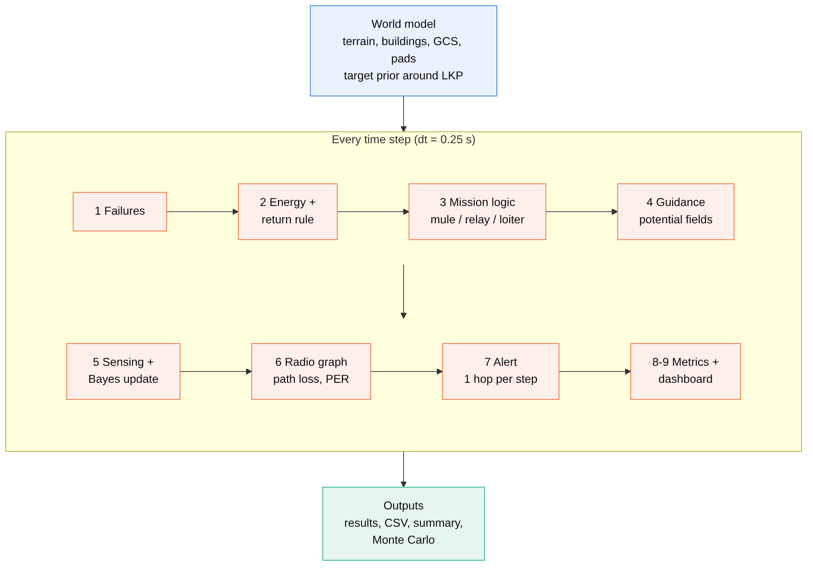
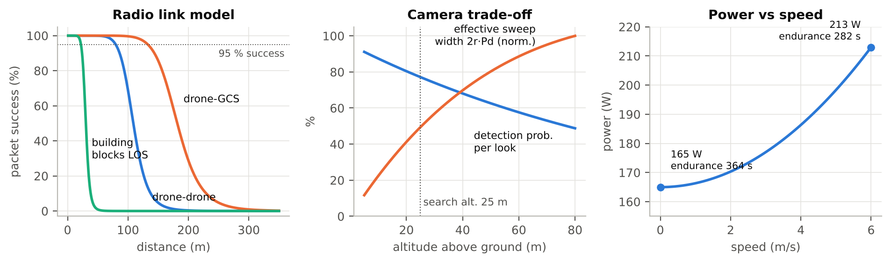
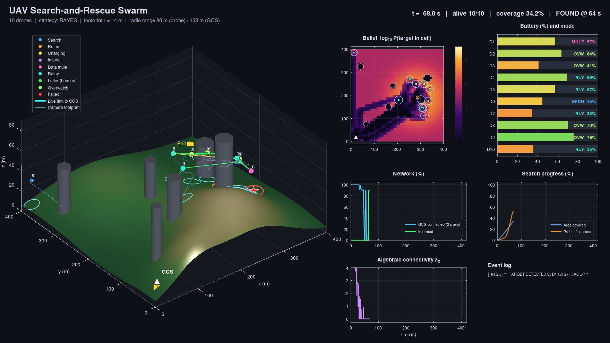
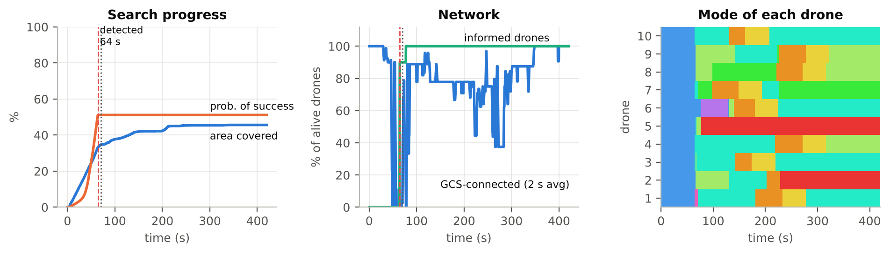
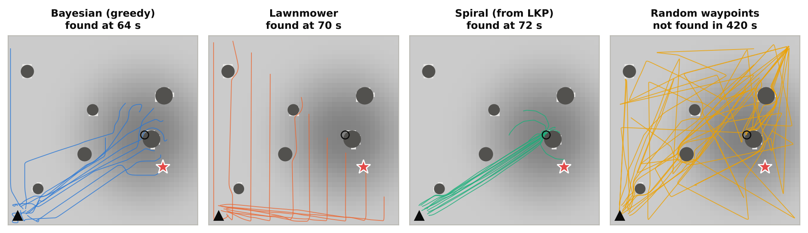
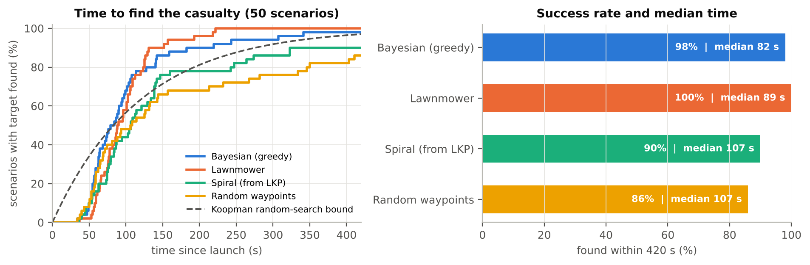

# Drone Swarm Rescue

A MATLAB simulation of a drone swarm that searches for a missing person and relays the detection back to a ground control station over a multi-hop wireless network.


## Overview

- **Search:** a probability map of the person's location, updated after every unsuccessful look
- **Strategies:** probability-guided, lawnmower, spiral and random search
- **Sensing:** camera footprint and detection probability depend on altitude
- **Radio:** signal fades with distance and is blocked by buildings
- **Reporting:** the alert hops drone to drone to the ground station; if cut off, the finder flies it back and other drones form a relay chain
- **Energy and failures:** drones return to charge based on distance, and can fail mid-mission





## Findings

### One mission






### Four strategies, same scenario



### 50 scenarios per strategy



| Strategy | Found within 7 min | Median time | Mean alert delay |
|---|---|---|---|
| Probability-guided | 98 % | 82 s | 2.7 s |
| Lawnmower | 100 % | 89 s | 2.9 s |
| Spiral | 90 % | 107 s | 5.1 s |
| Random | 86 % | 107 s | 1.3 s |

- Probability-guided search finds the person fastest in most cases.
- Lawnmower is the most reliable: it found the person in every scenario.
- Random search matches the theoretical random-search curve, which confirms the simulation behaves as expected.
- Once a drone finds the person, the ground station is alerted within a few seconds on average.

## Run

Open MATLAB, set the Current Folder to this repository, then:

```matlab
drone_swarm_rescue_v2                                        % settings window + live dashboard
R = drone_swarm_rescue_v2(struct('searchPattern','lawnmower'));  % bayes | lawnmower | spiral | random
run_monte_carlo(50)                                          % compare strategies (~10 min)
```

No toolboxes required.
