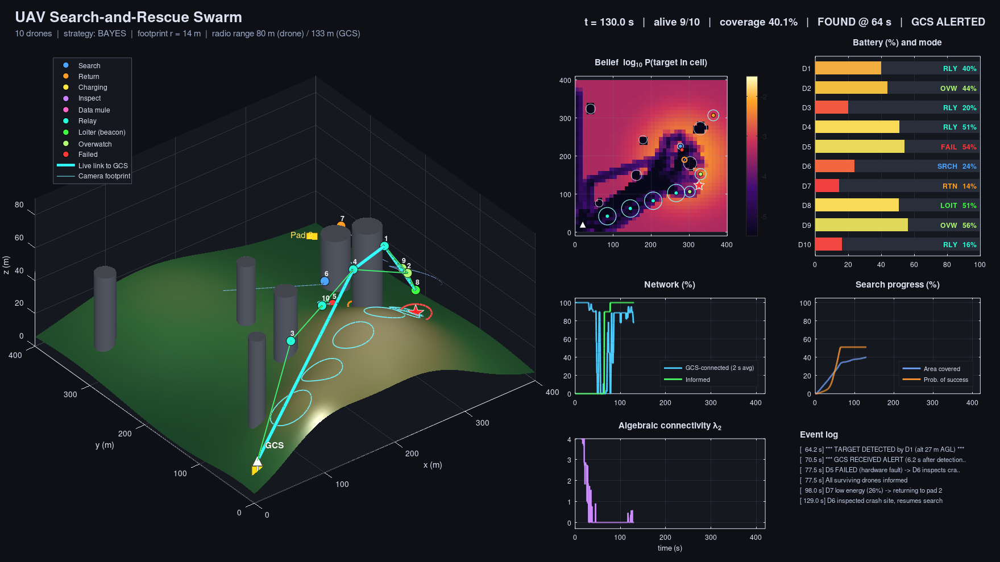

# Drone Rescue Swarm Communication (v2)

A MATLAB simulation of a drone swarm that searches for a missing person and reports the finding to a ground control station.



## What it models
- Bayesian search map and probability of success (POS)
- 4 search strategies: `bayes`, `lawnmower`, `spiral`, `random`
- Camera footprint and detection probability that depend on altitude
- Radio: path loss, shadowing, building blockage, packet error rate
- Multi-hop alert, data mule and relay chain to the ground station
- Energy-aware return to charging pads, random failures

## Run
```matlab
drone_swarm_rescue_v2                 % dialog + live dashboard
R = drone_swarm_rescue_v2(struct('searchPattern','lawnmower','seed',3));
run_monte_carlo(50)                   % compare strategies (headless)
```
No toolboxes needed. Also runs in GNU Octave 7+.

## Results (50 scenarios)
| Strategy | Found in 7 min | Median time |
|---|---|---|
| Bayesian | 98 % | 82 s |
| Lawnmower | 100 % | 89 s |
| Spiral | 90 % | 107 s |
| Random | 86 % | 107 s |

Full report: `docs/Drone_Rescue_Swarm_v2_Report.docx` · Demo video: `docs/swarm_v2_demo.mp4`

Authors: Niyathi Vedagiri (23BRS1132), Anna Sunny George (23BRS1321)
